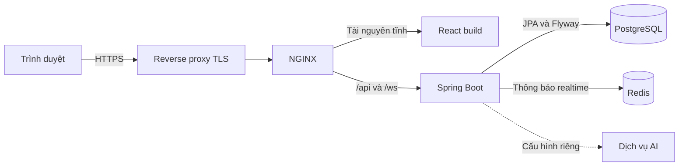

# Kiến trúc và bàn giao kỹ thuật TTJobs



Frontend là Git submodule trỏ đến `meomeohuhu/frontend-ttjobs`. Commit của repo chính ghim một phiên bản frontend cụ thể. Khi có thay đổi frontend, review ở repo frontend mà nhóm có quyền ghi, rồi cập nhật tham chiếu submodule bằng PR trong repo chính.

## Chạy trên máy phát triển

Cần Git, Docker Compose, JDK 17 và Node.js 22.

```bash
git clone --recurse-submodules https://github.com/TanTai08/TTJobs.git
cd TTJobs
docker compose up -d --wait postgres
```

Ở terminal backend, chạy `cd backend && ./mvnw spring-boot:run`. Trên PowerShell, chạy `cd backend` và `.\mvnw.cmd spring-boot:run`. Nếu cổng PostgreSQL 5432 đã được dùng, đổi cổng phía máy chủ trong Compose và cập nhật `SPRING_DATASOURCE_URL` bằng cổng đã chọn. Cung cấp mật khẩu đúng của volume đang dùng qua `SPRING_DATASOURCE_PASSWORD`.

Ở terminal frontend, chạy `cd frontend`, `npm ci` rồi khởi động Vite. Trên PowerShell, đặt `$env:VITE_API_BASE_URL = 'http://localhost:8080'` trước khi chạy `npm.cmd run dev`. Trên Bash, dùng `VITE_API_BASE_URL=http://localhost:8080 npm run dev`. Mở `http://localhost:5173`.

## Triển khai luồng cốt lõi lên HTTPS

Repo hiện gồm frontend và backend. Dùng Docker Compose v2.24.4 trở lên và một máy chủ Linux có Docker, reverse proxy TLS và tên miền đã trỏ DNS. Lấy mã với submodule, sao chép `.env.example` thành `.env` và đặt `POSTGRES_DB`, `POSTGRES_USER`, `POSTGRES_PASSWORD`, `JWT_SECRET`, `HTTP_PORT=8088`, `TTJOBS_APP_BASE_URL` và `TTJOBS_CORS_ALLOWED_ORIGINS`. Hai URL cuối dùng origin HTTPS của tên miền. Tạo JWT secret ngẫu nhiên bằng `openssl rand -hex 32`. Giữ email ở chế độ tắt nếu chưa cấu hình SMTP.

```bash
docker compose -f docker-compose.prod.yml -f docker-compose.core.yml config --quiet
docker compose -f docker-compose.prod.yml -f docker-compose.core.yml up -d --build --wait
```

Cấu hình reverse proxy TLS trên máy chủ trỏ đến `127.0.0.1:8088`, hỗ trợ WebSocket và giới hạn tải tệp phù hợp với cấu hình NGINX. Kiểm tra trang chủ và `/api/jobs` qua HTTPS, sau đó dùng một tài khoản thử nghiệm để đăng nhập, tìm việc, lưu tin và kiểm tra mục **Việc đã lưu**. Nếu môi trường nghiệm thu cần tin mẫu, dùng SQL trong `backend/src/main/resources/db/sample/` trên cơ sở dữ liệu demo sau khi Flyway hoàn tất.

Cấu hình này triển khai luồng tuyển dụng cốt lõi. Tính năng phụ thuộc AI cần mã nguồn và môi trường AI riêng. Ghi URL thực tế, ngày xác nhận và kết quả kiểm thử vào Issue trước khi bàn giao cho QA.
